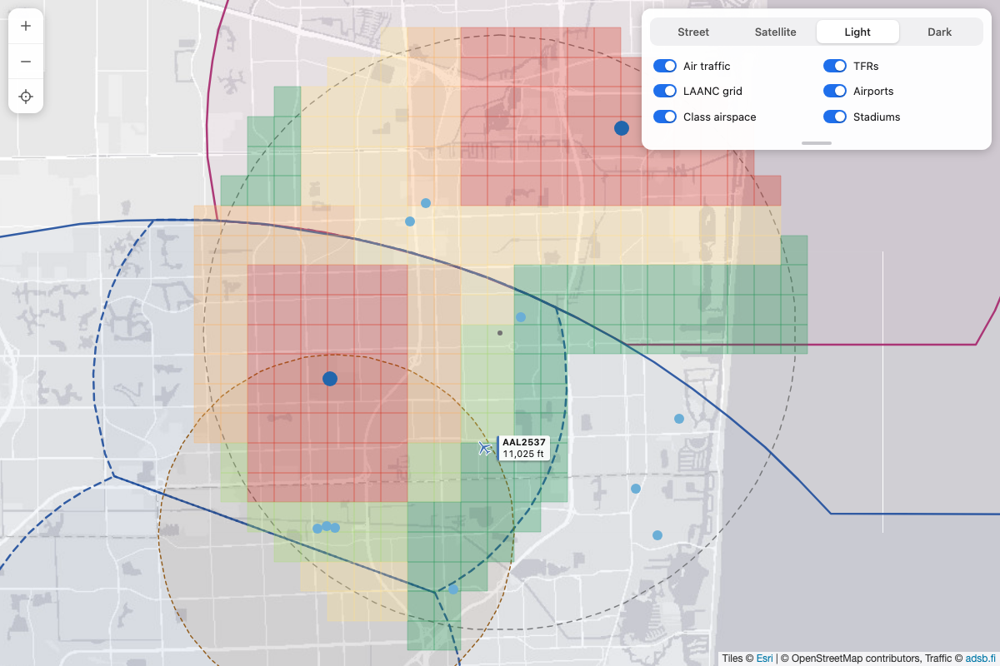

# drones-plugin

The `drones` agent skill and the `drones.py` CLI behind it, for drone pilots: FAA airspace for any
place in the US, on the command line or an interactive map, with aviation weather, a go/no-go
preflight and live air traffic when you want them.



## Features

- **Single-file executable** - Uses `uv run --script` with inline dependencies (PEP 723)
- **Airspace** - Controlled airspace, LAANC ceilings, special use and security airspace, TFRs and stadiums at a point or within a radius, plus TFRs close by
- **Interactive map** - Airspace loads as you pan and zoom, with fifteen-minute TFR refreshes, address/coordinate search and optional live traffic/radar; or export a fixed-area GeoJSON or PNG
- **Preflight** - Airspace plus the weather for when you plan to fly, as one GO / CAUTION / NO-GO verdict
- **METAR and TAF, decoded** - Current conditions and forecasts in plain language, with Part 107 and wind-limit checks
- **Nearest station logic** - Current conditions from the closest METAR station, forecasts from the closest airport that issues TAFs
- **Claude plugin** - The `drones` skill lets Claude answer "can I fly here?" and drone rules questions
- **No API keys** - FAA UAS Data Delivery System, tfr.faa.gov, NOAA Aviation Weather Center, adsb.fi, OpenStreetMap

## Prerequisites

- Python 3.10+
- [uv](https://github.com/astral-sh/uv) package manager

## Installation

### Claude Desktop

The plugin build is meant for Claude Desktop, including Cowork. The repo is a plugin marketplace
with one plugin, `drones`.

- Customize > Plugins > Add > Add marketplace, enter `vicgarcia/drones-plugin`, then add the `drones` plugin.
- Or download `drones-plugin-v*.zip` from [Releases](https://github.com/vicgarcia/drones-plugin/releases) and upload it as a custom plugin, or upload `drones-skill-v*.zip` under Customize > Skills to add just the skill.

The skill runs the script with `uv run --script`, so the environment needs uv and network access to PyPI (for the dependencies) and the data services: `services6.arcgis.com`, `tfr.faa.gov`, `aviationweather.gov` and `nominatim.openstreetmap.org`, plus `opendata.adsb.fi` and `opengeo.ncep.noaa.gov` for the live map. Cowork's sandbox allows package managers by default, but not these: add them under Settings > Capabilities (on Team and Enterprise, the organization's network egress allowlist), then start a new session. The interactive map needs a local machine with a browser. In a sandbox, Claude answers from `airspace` and `nearby` instead.

### Coding harnesses (Claude Code, pi)

In a coding harness, install `drones.py` as a command in your PATH and give the agent the skill.

1. Install [uv](https://github.com/astral-sh/uv). The script's PEP 723 header declares its
   dependencies, so uv installs them on first run; there is nothing else to set up.
2. Copy the script into a directory in your PATH and make it executable:

   ```bash
   git clone https://github.com/vicgarcia/drones-plugin.git
   cp drones-plugin/skills/drones/scripts/drones.py ~/.local/bin/drones.py
   chmod +x ~/.local/bin/drones.py
   drones.py --help
   ```

3. Copy the skill into your harness's skills directory (`~/.claude/skills/drones` for Claude Code,
   `~/.pi/agent/skills/drones` for pi):

   ```bash
   mkdir -p ~/.claude/skills/drones
   cp drones-plugin/skills/drones/SKILL.md ~/.claude/skills/drones/
   ```

4. As shipped, the skill runs `uv run --script ${CLAUDE_SKILL_DIR}/scripts/drones.py`, a path that
   only exists inside the plugin. Ask your agent to switch it to the installed command:

   > Update the drones skill in ~/.claude/skills/drones/SKILL.md to run `drones.py` from my PATH instead
   > of `uv run --script ${CLAUDE_SKILL_DIR}/scripts/drones.py`, including its `allowed-tools` line.

## Configuration

```bash
# Your aircraft's wind limit in knots (default 20); --max-wind overrides it
export DRONES_MAX_WIND=18

# Browser for map --png, when Chrome/Edge/Chromium is not found automatically
export DRONES_BROWSER="/path/to/chrome"
```

## Commands

| Command | What it answers |
|---------|-----------------|
| `airspace` | What airspace and restrictions apply at this point? |
| `nearby` | What airports, airspace and restrictions are within a radius? |
| `map` | Show me the airspace on a map |
| `preflight` | Can I fly here at this time? Airspace plus weather as one verdict |
| `metar` | What are conditions right now? |
| `taf` | What is the forecast? |
| `stations` | Which weather stations report near here? |

Every command takes a place name, an address, or `lat,lng` coordinates. `metar` and `taf`
also take station IDs (`KFLL`, or `KFLL,KMIA`).

## Usage

### Airspace

```bash
drones.py airspace "4406 Fillmore St, Hollywood, FL"
drones.py airspace 41.79,-87.74 --json
drones.py airspace "Montrose Beach" --near "Chicago, IL" --within 15
drones.py nearby "Navy Pier, Chicago"
drones.py nearby 38.8895,-77.0353 --radius 2
```

```
  Airspace check: 4406 Fillmore St, Hollywood, FL
  ==========================================================
  Verdict:    AUTHORIZATION REQUIRED
              LAANC available: near-instant approval up to 300 ft AGL through
              an FAA-approved LAANC app (Aloft, Autel, DJI FlightHub, etc.).

  Airspace at the surface
    Class D            HOLLYWOOD CLASS D  (SFC to 2,500 ft MSL)
                       part time: Legal description references NOTAM
    Overhead:          Class B MIAMI CLASS B from 3,000 ft MSL

  LAANC facility map (effective 10/1/2026)
    Ceiling:    300 ft AGL
    Airport:    KHWO North Perry

  Restrictions
    None - including 84 published TFRs checked

  TFRs within 10 NM (not over this point)
    6.4 NM NE  TFR (uas public gathering): Fort Lauderdale, FL, Wednesday, October 28, 2026 ...
              unknown | SFC to 400 ft AGL | times unavailable - treat as active
```

`airspace` judges one point: surface class, the LAANC facility map ceiling and the airports
behind it, special use and security airspace, TFRs over the point, and stadiums within 3 NM.
TFRs within 10 NM that miss the point are listed apart and don't change the verdict. `nearby`
lists everything within `--radius` NM (default 5, max 30), with TFRs always out to 30 NM.

### Preflight

```bash
drones.py preflight "Hollywood, FL"
drones.py preflight "Hollywood Beach, FL" --at "tomorrow 7am" --max-wind 15
drones.py preflight 41.79,-87.74 --at 2pm --altitude 200 --json
```

```
  Preflight: Young Circle, Hollywood, FL
  ==========================================================
  When:       Sun 9:32 PM (400 ft AGL, 20 kt wind limit)
  Verdict:    CAUTION
              - gusts 19 kt near your 20 kt limit
              - cumulonimbus nearby
              Requires: LAANC available: near-instant approval up to 400 ft
              AGL through an FAA-approved LAANC app (Aloft, Autel, DJI
              FlightHub, etc.).

  Airspace
    AUTHORIZATION REQUIRED: Class C FORT LAUDERDALE CLASS C
    LAANC ceiling 400 ft AGL

  Weather
    Ft Lauderdale-Hollywood Intl (KFLL) · 4.2 NM NNW of Young Circle, Hollywood, FL
    Observed 8:53 PM EDT (00:53Z): VFR, wind ENE 60° at 10 kt (12 mph),
    gusting 19 kt (22 mph), visibility 10+ statute miles, clouds scattered
    2,600 ft (cumulonimbus)
      ⚠ gusts 19 kt near your 20 kt limit
      ✓ visibility meets 3 SM
      ✓ clouds clear of 400 ft + 500 ft
      ⚠ cumulonimbus nearby
```

Within the hour the nearest METAR decides; later times use the TAF period in force plus any
TEMPO/PROB overlays, whose failures only raise CAUTION. An active TFR, prohibited area or
national defense airspace is NO-GO regardless of weather. Exits 3 on NO-GO.

TFRs are judged at the time you ask about. The FAA's shape feed lists scheduled TFRs alongside
active ones and carries no times or altitudes, so drones.py reads each nearby TFR's NOTAM text:
active means NO-GO, scheduled means CAUTION with its window (e.g. "scheduled Tue Oct 27
10:30 AM EDT to 4:00 PM EDT"), expired is dropped, and one whose text can't be fetched is
treated as active.

### Weather

```bash
drones.py metar "Hollywood, FL"
drones.py metar KFLL,KMIA --max-wind 15
drones.py taf "Hollywood, FL"
drones.py taf KMIA --raw
drones.py stations "Hollywood, FL" --taf-only
```

```
  TAF Ft Lauderdale-Hollywood Intl (KFLL) · 4.2 NM NNW of Young Circle, Hollywood, FL
  Issued 7:20 PM EDT (23:20Z) · valid Sun 8 PM - Tue 2 AM
  ==========================================================
  Sun 8 PM - Mon 12 AM   VFR  · NE 15 G25 kt · 6+ SM · showers in the vicinity · scattered 2,000 ft, broken 6,000 ft
                         ✗ gusts 25 kt over your 20 kt limit
  Mon 12 AM - Mon 12 PM  VFR  · NE 12 G22 kt · 6+ SM · showers in the vicinity · scattered 2,000 ft, scattered 6,000 ft
                         ✗ gusts 22 kt over your 20 kt limit
```

METAR and TAF pick their stations independently: the nearest METAR station for conditions
(about 2,900 in the US), the nearest TAF airport for forecasts (about 860), skipping
part-time TAF airports that have no current forecast. A TAF covers 5 SM around its airport,
so one more than 10 NM away comes with a warning.

Decoding goes beyond AWC's JSON where it falls short: cumulonimbus and towering cumulus are
recovered from the raw report (the JSON drops the `CB` tag), remark hazards such as
`CB ALQDS MOV SW` and lightning are spelled out, and TAF periods get a computed flight
category.

**Drone checks:** wind and gusts against `--max-wind` (warning within 85% of it), Part 107's
3 SM visibility, and 500 ft below clouds at your `--altitude` (default 400 ft AGL), plus
thunderstorms, cumulonimbus, precipitation and fog.

### Map

```bash
drones.py map "4406 Fillmore St, Hollywood, FL"
drones.py map 41.79,-87.74 --radius 2 --tiles satellite
drones.py map "Denver, CO" --geojson > denver.geojson
drones.py map "Navy Pier, Chicago" --radius 2 --png navy-pier.png
drones.py map 41.79,-87.74 --png midway.png --tiles satellite --size 1920x1080
drones.py map "Chicago Midway Airport" --adsb --radar
```

The map shows airspace only unless you opt in to live traffic or radar: the LAANC grid colored
by ceiling (red at 0 ft to green at 400 ft, with the number on each cell once zoomed in), class
airspace in sectional chart style, special use, prohibited, defense and security areas, TFRs,
stadiums and airports. Clicking a feature shows its details. A Kestrel-style rounded card at
top right combines search, segmented basemap choices and layer switches; its bottom handle
collapses the options. Matching zoom/location buttons sit at top left, with freshness/errors in
a bottom status pill. On phones the options start collapsed; only the panel's open/closed state
is remembered, never a previous location overriding the CLI launch point. Provider attribution
stays visible. The original search center and radius ring stay drawn as a reference. Basemaps are `street`
(default), `satellite`, `light` and `dark`, all switchable on the map. The launch/export radius
is 5 NM by default (up to 30), as for `nearby`.

**Browse:** panning or zooming loads the enabled airspace layers for the new viewport, after a
250 ms pause. Regional views up to 120 NM across are supported; broader views show a zoom-in
warning rather than silently pretending all airspace was loaded. Server-side FAA results are
cached for six hours in bounded memory, and identical concurrent requests share one fetch.
Disabled layers stay disabled. Airport distances in popups remain relative to the launch point.

**TFRs:** shapes and NOTAM timing details are rechecked every **15 minutes**, independently of
the ordinary airspace cache, with earlier redraws at known TFR start/end times. The map
includes TFRs intersecting the viewport and within 30 NM
of its center. The status panel shows the oldest relevant fetch time. Failed or partial refreshes
retain restrictions and display a stale/incomplete warning; failures retry after 30 seconds.
Returning to a visible tab checks freshness. Fifteen-minute polling is not real-time FAA clearance.

**Search:** type an address, place, or `lat,lng` and press **Enter** or Search. One result
recenters directly; multiple results offer a selection. Coordinates bypass the geocoder.
Search never runs on each keystroke; requests share a paced Nominatim client and cached results.
A separate search pin is added without moving the original radius ring. Searching does not
perform an `airspace` verdict or grant authorization.

**Exports:** `--geojson` and `--png` remain snapshots around the requested launch point, with
TFRs out to 30 NM. PNGs have no interactive search or viewport/TFR refreshes.

`--adsb` adds live air traffic from [adsb.fi](https://adsb.fi), polled every 3 seconds and coloured by
altitude; aircraft on the ground are left off. Coverage comes from volunteer ground receivers, so low traffic far from a feeder and
aircraft without ADS-B are missing: situational awareness, not see-and-avoid. `--radar` adds
NOAA's MRMS base reflectivity mosaic (lower 48), refreshed every 2 minutes. Both are toggles on
the map, and neither affects `--geojson`. If their toggles are absent, the map was launched
without those flags; use `--adsb --radar` to include both.

Serves on `127.0.0.1`, falls back to a free port if 8765 is taken, and runs until Ctrl+C.

## Data Sources

| Data | Source |
|------|--------|
| LAANC grid, class airspace, special use, prohibited and defense airspace, national security UAS restrictions, stadiums, airports | FAA UAS Data Delivery System - the public ArcGIS layers behind the FAA UAS Facility Map |
| TFR shapes, NOTAM text (effective times, altitudes) and links | tfr.faa.gov |
| METAR, TAF and the station index | NOAA Aviation Weather Center (aviationweather.gov) |
| Live air traffic (`map --adsb`) | adsb.fi open data API |
| Weather radar (`map --radar`) | NOAA MRMS base reflectivity WMS |
| Geocoding | OpenStreetMap Nominatim |

All free with no key. Nominatim allows 1 request a second (paced automatically), AWC about 100
a minute. Not covered: NOTAMs other than TFRs (the FAA NOTAM API needs a key), LAANC filing
(only approved suppliers can submit), real-time activation of NOTAM-activated airspace (shown
as CAUTION), and airspace outside the US.

> Advisory only - FAA data is not real time and is not an authorization to fly. Confirm with
> B4UFLY or a LAANC app and check NOTAMs before you fly.

[WIKI.md](WIKI.md) is the development reference: every FAA layer and field, how TFR times are read,
the AWC endpoints and JSON quirks, how stations are chosen, the live traffic and radar feeds, Part 107
weather rules, how the skill's drone rules material was sourced and is kept current, and the
reasoning behind the skill and map defaults.

## Development

Run the offline regression suite (service calls are mocked, network access is refused):

```bash
uv run --with 'geopy>=2.4.0' --with 'requests>=2.31.0' python -m unittest discover -s tests -v
```

Optional browser regressions use an installed Chrome/Edge/Chromium and intercept all map/data
requests. They download only the pinned Leaflet JS/CSS, never live FAA/weather/traffic data:

```bash
DRONES_BROWSER_TESTS=1 uv run --with geopy --with requests --with playwright python -m unittest discover -s tests -p test_map_browser.py -v
```

These browser tests are skipped by the default offline suite.

## Agent Skill

The skill lives in `skills/drones/` (`SKILL.md` plus `scripts/`). It answers "can I fly here?" with
a short verdict card, sizes up mission areas, and opens the map when asked. It treats airspace as the default question: weather, live traffic and radar only come in when
you ask for them. It also acts as a UAS pilot expert, answering Part 107 and recreational rules
questions from the regulations in effect, with links to the eCFR sections and FAA pages behind
each rule.

### Installation

See [Installation](#installation): the plugin for Claude Desktop, or the script in your PATH plus `SKILL.md` for Claude Code, pi and other coding harnesses.

### Usage

Once installed, ask naturally:

> "Can I fly my drone at 4406 Fillmore St in Hollywood?"
> "Can I fly at Hollywood Beach tomorrow morning, and what's the wind doing?"
> "What's the weather at KFLL right now?"
> "Is there a TFR near Navy Pier today?"
> "Show me the airspace around Midway on a map"
> "Show me a live view with air traffic around FLL"
> "Can I fly at night under Part 107, and what lights do I need?"
